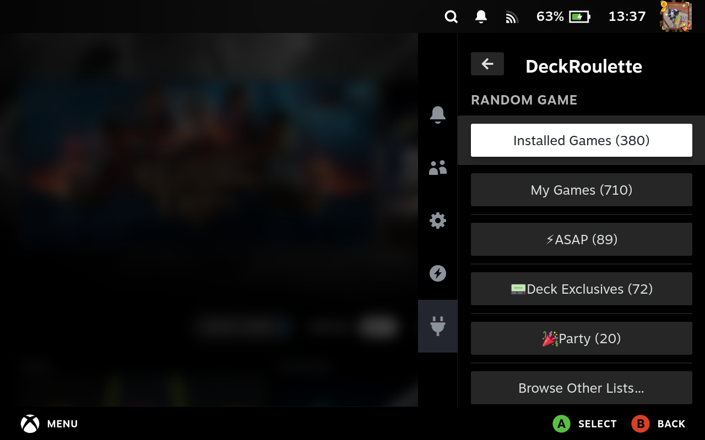

# DeckRoulette

A Decky Loader plugin that picks a random game from your Steam library. Open
DeckRoulette from the Decky tab in Quick Access and choose **Installed Games**,
**My Games**, or a Steam collection.



## Customize your lists

- Pin and reorder your favorite lists in **Shortcuts**. Use **Browse Other Lists**
  to roll from lists that aren't pinned.
- Use **Exclusions** to skip games from selected collections when rolling from
  **Installed Games** or **My Games**. You can still roll from those collections
  directly.

## Advanced Settings

- **Show Game Counts** displays the number of eligible games next to each list.
  It's on by default.
- **YOLO Mode** launches installed picks right away. Uninstalled picks still open
  their game page. It's off by default.

## Development

```sh
pnpm install --frozen-lockfile
pnpm test
pnpm build
```
